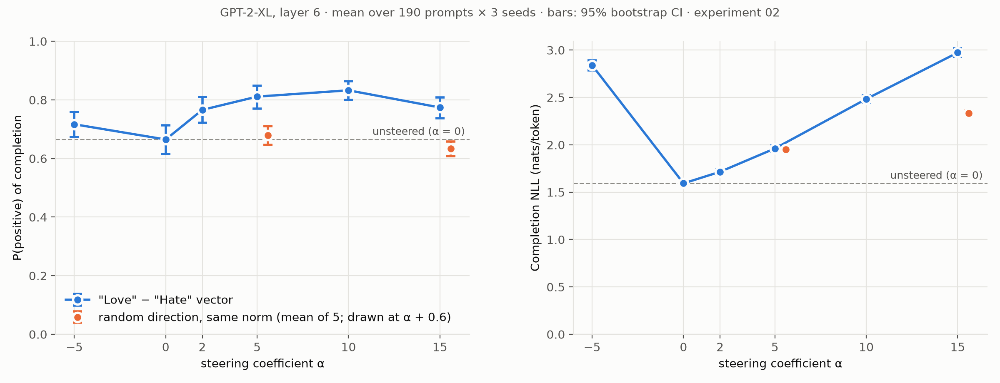
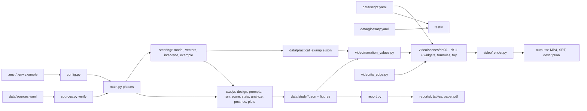

# Steering Vectors, From Scratch

A narrated, 3Blue1Brown-style animated explainer of **steering vectors in large language models**. It defines every
symbol from scalars upward, uses worked examples throughout, and quotes papers verbatim. It is grounded in **real
GPT-2-XL runs, including two pre-registered experiments**, whose measured numbers appear in the video. Every claim was
independently fact-checked; findings, sources and fixes: [`docs/fact_check.md`](docs/fact_check.md).

* **Video (MP4, 1080p30, 13:12, 12 chapters + subtitles):** download from
  [GitHub Release v1.0](https://github.com/BurnyCoder/steering-vectors-explained/releases/tag/v1.0). Transcript/subtitles:
  [`outputs/steering_vectors_explained.srt`](outputs/steering_vectors_explained.srt); chapter list and all sources:
  [`outputs/description.md`](outputs/description.md).
* **Paper (PDF):** [`reports/paper/paper.pdf`](reports/paper/paper.pdf). Author: Libor Burian, independent researcher.

## What the video explains (methodology of the explainer)

It starts and ends with the two equations below. On the way, every symbol is built step by step and annotated
with the set it belongs to:

$$v_\ell=\frac{1}{|\mathcal{D}|}\sum_{(p,c^+,c^-)\in\mathcal{D}}\Big[a_\ell(p,c^+)-a_\ell(p,c^-)\Big],\qquad \tilde h_\ell^{(t)}=h_\ell^{(t)}+\alpha\,v_\ell\ \ (t\in T)$$

1. The **mean-difference steering vector** of CAA (Rimsky et al., ACL 2024). ActAdd (Turner et al.) is close to
   the single-pair case: it has no completions and keeps one difference vector per front position.
2. The **intervention** that adds it to the residual stream.

The 12 chapters (structure: [`docs/storyboard.md`](docs/storyboard.md)) cover:
* scalars, vectors and ℝ^d;
* vector arithmetic: sum, mean, dot product, norm;
* tokens, vocabulary and embeddings;
* layers and the residual stream;
* logits, softmax and sampling;
* the linear representation hypothesis;
* building v (ActAdd and CAA);
* applying it;
* our experiments;
* limits and relatives: ITI, RepE, directional ablation, Golden Gate Claude;
* a symbol-by-symbol recap.

**How correctness is enforced, not just intended:**
* **Verbatim quotes.** All 40 quotes (28 shown on screen) live in [`data/sources.yaml`](data/sources.yaml). The `verify_sources` phase
  and a test download each source and check every quote is a verbatim substring. Non-CC-BY-4.0 quotes are
  limited to 15 words (tested). Generated list: [`docs/sources.md`](docs/sources.md).
* **No hand-typed numbers.** Toy examples are computed by [`video/toy.py`](src/steering_explainer/video/toy.py)
  in exact arithmetic (pinned by tests). Real numbers come from JSON written by the experiment code. Narration
  numbers are `{placeholders}` filled from those files.
* **Define before use.** [`data/glossary.yaml`](data/glossary.yaml) maps 51 terms to the chapter that defines
  them, and [`tests/test_script.py`](tests/test_script.py) fails if narration uses a term earlier.
* **Visual QA.** Every chapter is rendered, turned into a contact sheet of frames (`--phases inspect`), and
  checked for clipped or overlapping elements.

## The experiment behind the numbers (methodology)

* **Model:** GPT-2-XL (48 layers, d = 1600, 1.56 B parameters), float16, Hugging Face `transformers`. No training.
* **Steering vector:** ActAdd "Love" − "Hate" read at the **input of block 6** (= `blocks.6.hook_resid_pre`),
  with coefficient +5 and sampling settings from the official ActAdd code (temperature 1, top-p 0.3, frequency
  penalty 1). It is added by a PyTorch forward pre-hook at the first n positions. The hook is KV-cache safe and
  unit-tested.
* **Data:** first 8 words of IMDb test reviews, with disjoint pilot / experiment-1 / experiment-2 prompt sets.
* **Conditions per prompt × 3 seeds:** α ∈ {−5, 0, 2, 5, 10, 15}, plus 5 random directions with the same
  per-position norm at α ∈ {5, 15}.
* **Metrics:**
  * SiEBERT P(positive) of the continuation (primary);
  * NLL of the continuation under the unsteered model (fluency cost).
* **Statistics:** paired by prompt, 10,000-resample bootstrap CIs, Wilcoxon + Holm, pilot-based power analysis.
  Both experiments were **pre-registered and committed before data**
  ([exp01](reports/exp01_preregistration.md), [exp02](reports/exp02_preregistration.md)).

## Results

| Experiment | Main contrast (P(positive), 95% CI) | Verdict |
|---|---|---|
| 01, N = 30 | steered(α=5) − random(α=5) = +0.125 [+0.045, +0.203] | supported |
| 02, N = 190 | steered(α=5) − unsteered = +0.146 [+0.102, +0.192] | supported |
| 02 | steered(5) − random(5) (re-test) = +0.132 [+0.097, +0.166] | replicated |
| 02 | α = −5 vs. 0 = +0.052 [−0.000, +0.105] | negation does **not** reverse the effect |
| 02 | NLL cost at α = 15: +1.38 nats/token (random: +0.74) | steering hurts fluency |

* Mean positivity is highest at α = 10 and lower at α = 15 (descriptive). The pre-registered dose-response test
  (H2, per-prompt Spearman ρ) failed in experiment 01 and held in experiment 02.
* A **post-hoc** (exploratory) analysis suggests the vector injects the words more than the sentiment. The whole word
  "love" appears in 61.4% of α = 5 continuations versus 5.6% unsteered; "hate" appears in 22.5% at α = −5 versus 0.4%.
  The α = −5 continuations that contain "hate" average P(positive) 0.665, the same as unsteered text (0.665).

All tables are generated: [`reports/results_tables.md`](reports/results_tables.md). Reports:
* [exp01](reports/exp01_love_hate_dose_response.md);
* [exp02](reports/exp02_powered_replication.md);
* [all experiments + learnings](reports/all_experiments.md);
* [plain-language summary](reports/summary.md).



## Install and setup (Windows tested; Linux/macOS: install the same tools with your package manager)

1. **Python tooling:** [uv](https://docs.astral.sh/uv/). Python 3.12 is installed by uv.
2. **System tools:**
   * [ffmpeg](https://ffmpeg.org/) on `PATH`.
   * LaTeX for Manim's `MathTex` (`winget install MiKTeX.MiKTeX`, then
     `initexmf --set-config-value "[MPM]AutoInstall=1"`).
   * Pandoc for the paper (`winget install JohnMacFarlane.Pandoc`).
   * Optional: SoX (`winget install ChrisBagwell.SoX`, silences a manim-voiceover warning) and Poppler (PDF previews).
3. **GPU:** an NVIDIA GPU with ≥ 8 GB is recommended. The PyTorch CUDA 12.8 wheels come from the index
   configured in `pyproject.toml`. CPU works but is slow (`DEVICE=cpu`).
4. **Clone and sync:**

```bash
git clone https://github.com/BurnyCoder/steering-vectors-explained.git
```

```bash
uv sync
```

5. **Configuration:** all settings and their defaults are in [`.env.example`](.env.example). Copy it to `.env`
   to override anything (model, layer, α grid, seeds, voice, render quality, tool paths). Hugging Face
   downloads go to `.cache/hf` inside the repo; GPT-2-XL is about 6.4 GB. **Internet is needed** for model and
   dataset downloads, source verification, and edge-tts narration (audio is cached afterwards).

## Usage

Run everything (each phase is resumable):

```bash
uv run steering-explainer
```

Or run selected phases:

```bash
uv run steering-explainer --phases verify_sources practical_example
```

```bash
uv run steering-explainer --phases render --chapters ch07 --quality l
```

```bash
uv run steering-explainer --phases render assemble
```

Tests:

```bash
uv run pytest -m "not gpu and not network"
```

```bash
uv run pytest
```

| Phase | What happens | Output |
|---|---|---|
| `verify_sources` | downloads every cited source once, checks all quotes verbatim | log; `data/cache/sources/` |
| `practical_example` | GPT-2-XL "Love" − "Hate": vectors, norms, probabilities, seeded completions | `data/practical_example.json` |
| `preregister` / `preregister2` | writes the pre-registration documents (commit them before data!) | `reports/exp0*_preregistration.md` |
| `pilot` → `study` → `analyze` | pilot + power analysis, experiment 1, analysis | `data/study/{pilot,main}.jsonl`, `summary.json`, figures |
| `replicate` | experiment 2 (powered) + analysis | `data/study/exp02*.json*`, figures |
| `posthoc` | exploratory lexical analysis, whole-word love/hate counts (labelled post-hoc) | `data/study/*_posthoc.json` |
| `figures` | redraws both dose-response figures from the summary JSONs (no GPU, no new data) | `reports/figures/*.png`, `data/study/*dark.png` |
| `render` | Manim chapters with edge-tts narration (`--chapters`, `--quality l/m/f/h/k`) | `media/videos/chNN_*/…/ChNN.mp4` + `.srt` |
| `inspect` | contact sheet of frames per chapter | `outputs/check/*.png` |
| `assemble` | lossless concat, chapter markers, merged subtitles, description | `outputs/steering_vectors_explained.{mp4,srt}`, `outputs/description.md` |
| `docs` / `tables` / `paper` | generated glossary + sources docs, results tables, PDF | `docs/*.md`, `reports/results_tables.md`, `reports/paper/paper.pdf` |

## Data flow (what happens when you run it)

1. Sources are downloaded and every quote is verified.
2. GPT-2-XL is loaded once per run. The steering vector is read from the residual stream entering block 6.
3. Real numbers and completions are written to JSON. Every prompt and completion is logged in full to
   `logs/run_<timestamp>.log`.
4. Study runs generate one batch per (prompt, seed) holding all 16 conditions, score each completion with
   SiEBERT, and compute its NLL with the hook removed.
5. The analysis writes summaries and figures.
6. Manim scenes read the JSON results and narration; edge-tts speaks each beat (cached per chapter); scenes
   render.
7. ffmpeg concatenates chapters into the final MP4 with chapter markers and subtitles.

## Architecture



Module responsibilities and invariants: [`docs/architecture.md`](docs/architecture.md). Contributor/agent rules:
[`AGENTS.md`](AGENTS.md).

## Features and technologies

* **Video:** [Manim Community](https://www.manim.community/) 0.22 (animation + LaTeX via MiKTeX),
  [manim-voiceover](https://voiceover.manim.community/) 0.4 with a custom
  [edge-tts](https://github.com/rany2/edge-tts) 7.3 service (word-level bookmark sync), ffmpeg (concat,
  chapters), subtitles via `srt`.
* **Steering:** PyTorch 2.11 (CUDA 12.8), Hugging Face transformers 5.20, GPT-2-XL; a TransformerLens-style
  sampler.
* **Study:** Hugging Face datasets (IMDb), SiEBERT classifier, scipy / statsmodels (bootstrap, Wilcoxon, Holm,
  power), matplotlib.
* **Grounding:** requests + BeautifulSoup + pypdf (quote verification); pytest (20 non-GPU tests incl. 1 network test, + 8 GPU tests);
  Pandoc + XeLaTeX (paper).

## Limitations

* **One setting only:** one model, one layer, one vector, one prompt distribution, one binary classifier.
* **Metric:** sentiment is confounded with the lexical mention of "love" (post-hoc).
* **Control:** random directions are a weaker control than an unrelated real steering vector.
* **Narration:** edge-tts needs internet the first time a narration line is synthesised.

Details: [`reports/all_experiments.md`](reports/all_experiments.md).

## Key sources

Turner et al. 2024 (ActAdd, arXiv:2308.10248) · Rimsky et al. 2024 (CAA, ACL) · Subramani et al. 2022 ·
Li et al. 2023 (ITI) · Zou et al. 2023 (RepE) · Arditi et al. 2024 · Tan et al. 2024 · Park et al. 2024 ·
Elhage et al. 2021 · Templeton et al. 2024 · Chen et al. 2025 · Mikolov et al. 2013 · Radford et al. 2019.
Full list with links and the verbatim quotes: [`docs/sources.md`](docs/sources.md).
