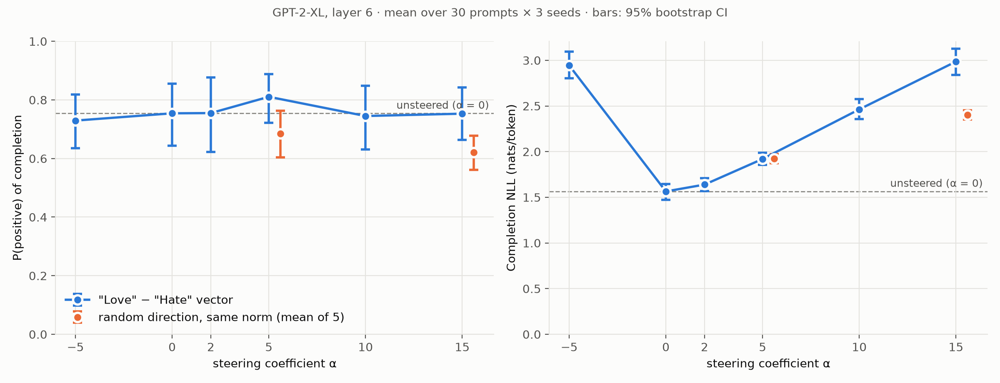

# Experiment 01 — Does the "Love" − "Hate" ActAdd vector make GPT-2-XL more positive than a random push of the same size?

*Author: Libor Burian (independent researcher). Pre-registration: [exp01_preregistration.md](exp01_preregistration.md)
(committed in `7da591f` before any data). All numbers: [results_tables.md](results_tables.md) (generated from
`data/study/summary.json`). Raw completions: `data/study/main.jsonl`; pilot: `data/study/pilot.jsonl`.*

## Question and why
The video's practical example reproduces ActAdd's "Love" − "Hate" demo (Turner et al. 2023/2024). Single
demonstrations were selected best-of-3 in the original post, so the experiment asks whether the effect holds on
unrelated text without selection, and whether it is specific to that direction. The control answers "is any
push of that size enough?" (random directions of identical per-position norm).

## Method
* **Model:** GPT-2-XL (1.56 B parameters, L = 48, d = 1600), float16, Hugging Face `transformers`.
* **Vector:** h_A = h₆("<|endoftext|>Love·") − h₆("<|endoftext|>Hate"), where h₆ is the residual stream
  entering block 6. GPT-2 tokenizes "Hate" as "H" + "ate", so "Love" is right-padded with a space token,
  following ActAdd's Algorithm 1 and Appendix C. Position 0 is identical in both prompts, so h_A⁽⁰⁾ = 0 (measured).
* **Intervention:** h̃⁽ᵗ⁾ = h⁽ᵗ⁾ + α·h_A⁽ᵗ⁾ for t ∈ {0, 1, 2}, implemented as a forward pre-hook on block 6.
  It uses absolute position ids, so cached and uncached generation are identical (unit-tested).
* **Data:** IMDb test reviews (Maas et al. 2011), shuffled with seed 0, labels alternating negative/positive,
  first 8 words. Pilot = prompts 0-19; experiment = prompts 20-49 (disjoint).
* **Conditions per prompt and seed** (one batch, paired):
  * steered with α ∈ {−5, 0, 2, 5, 10, 15};
  * random directions (R = 5, fixed seed 1234) at α ∈ {5, 15}.
* **Sampling:** temperature 1, top-p 0.3, frequency penalty 1 (official ActAdd settings), 40 new tokens,
  3 sampling seeds.
* **Primary metric:** P(positive) of the completion alone, from SiEBERT (Hartmann et al. 2023).
  **Secondary metric:** completion NLL under the unsteered model.
* **Sample size:**
  * Pilot: d_z = 0.633, so 22 prompts give 80% power.
  * The pre-registered floor (N ≥ 30) gives **N = 30**.
* **Statistics:**
  * Per-prompt averages.
  * 10,000-resample percentile bootstrap CIs.
  * Wilcoxon signed-rank tests with Holm correction over the secondary family.
  * Per-prompt Spearman ρ for the dose-response hypothesis.

## Results (pre-registered)
| Hypothesis | Estimate [95% CI] | Verdict |
|---|---|---|
| **H1 primary:** steer(5) − random(5) | +0.125 [+0.045, +0.203] | **supported** |
| H2: monotone dose-response (mean ρ) | +0.074 [−0.086, +0.225] | falsified |
| H3: α = −5 lowers positivity | −0.025 [−0.153, +0.105], Holm p = 1 | falsified |
| H4: fluency cost, NLL(15) − NLL(0) | +1.422 [+1.259, +1.584] | supported |

Further results:
* **Steered vs. unsteered at α = 5:** +0.056 [−0.042, +0.155], Holm p = 0.22, not significant.
* **Part of the H1 gap comes from the control:** random directions *lowered* positivity
  (0.685 vs. 0.754 at α = 0).
* **Seed robustness:** each seed's CI of the primary contrast barely touches 0 (seeds 0 and 2) or barely
  excludes it (seed 1). The pooled estimate is driven by all three seeds together.

## Interpretation
* The direction is special: it beats an equal-norm random push.
* With 30 prompts, the experiment cannot show that steering beats *doing nothing*. The pre-registered power
  analysis targeted the primary contrast (d_z ≈ 0.6), while the steered-vs-unsteered contrast is smaller
  (d_z = 0.205 measured here), so it was underpowered.
* This motivated [experiment 02](exp02_powered_replication.md), pre-registered with N = 190.

## Learnings
* A random-direction control is not neutral. Equal-norm perturbations changed the metric themselves (lower
  positivity, +0.36 nats NLL at α = 5). So "steered − random" and "steered − unsteered" answer different
  questions, and both need to be reported.
* A power analysis covers only the contrast it is computed for. Secondary contrasts can be badly underpowered.
